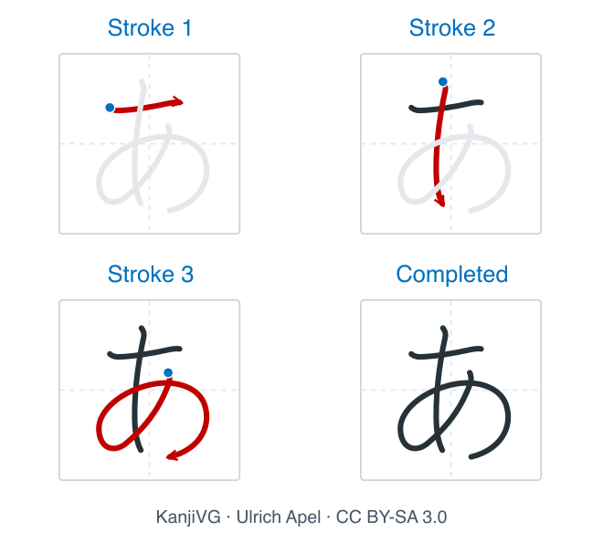

**English** · [简体中文](README.zh-CN.md)

# Japanese Kana and Everyday Expressions

545 Anki cards for Japanese beginners, with complete English-explanation and Chinese-explanation editions. Learn hiragana and katakana, practice kana handwriting, and connect written forms with everyday Japanese words and expressions.

## Choose an edition

Choose the language you prefer for explanations. Each download is a complete, independent 545-card deck, so one edition is enough to study all the content.

- [English explanations](https://github.com/frankeenld-hub/Anki-Learning-Japanese-Hinagana-and-Katagana/releases/latest/download/Japanese-Kana-Foundations-English.apkg)
- [Chinese explanations](https://github.com/frankeenld-hub/Anki-Learning-Japanese-Hinagana-and-Katagana/releases/latest/download/Japanese-Kana-Foundations-Chinese.apkg)

Both editions teach Japanese. The English edition uses English to explain Japanese readings and meanings.

## Contents

| Section | Cards in each edition |
| --- | ---: |
| Hiragana reading | 108 |
| Katakana reading | 105 |
| Kana handwriting | 217 |
| Everyday Japanese | 115 |
| **Total** | **545** |

Hiragana reading includes 104 kana cards and 4 reading tips. Katakana reading includes 104 kana cards and 1 reading tip.

Kana follow gojuon rows, with five grouped together where appropriate, such as かきくけこ (ka ki ku ke ko). Contracted sounds are grouped in threes. Small kana and long-vowel content have separate groups.

## What the cards show

Comparison tables use 32 px kana and 22 px romaji to make neighboring sounds and shapes easier to compare. The green Notes disclosure uses native HTML details and opens by default. You can collapse it when testing your recall.

Japanese examples include phonetic romaji as a pronunciation aid. For example, こんにちは appears as konnichiwa because the final は is pronounced wa in this greeting. Romaji supports the transition to reading kana and does not replace the Japanese text.

Everyday Japanese cards also connect written forms and readings, such as 山 → やま → ヤマ (yama, mountain). The katakana column is an exercise in matching the two kana scripts. A limited number of uncommon sound combinations are explicitly labeled as practice combinations for sound drills.

Handwriting cards use SVG diagrams. Red marks the current stroke, black shows completed strokes, blue dots mark starting points, and arrows indicate writing direction.

## Import and study

1. Download the .apkg file for your preferred explanation language.
2. Open Anki and import that file.
3. Set a modest daily new-card limit in the deck options. Begin with a reading section and adjust the limit to a pace you can sustain.
4. Try to recall the answer before revealing it, then read the notes and repeat the Japanese aloud.
5. For handwriting cards, copy the diagram, try again from memory, and compare the finished shape.

## Japanese speech

Every card uses Anki-native ja_JP text-to-speech. Playback needs a compatible client and an available Japanese voice. Linux also needs a compatible TTS engine or add-on. Speech quality and pronunciation depend on the voice available on your device. No prerecorded audio files are bundled.

If a card is silent, check Japanese voice availability and your client's TTS support. See the [official Anki TTS documentation](https://docs.ankiweb.net/manual/templates/fields).

## Educational content

The explanations, prompts, and examples were newly authored for this project using common kana values, spelling conventions, and everyday lexical facts. The material was prepared with AI assistance and checked for readings, examples, formatting, and package integrity. These cards provide introductory study and practice material.

## Credits and license

The newly authored educational content and adapted stroke diagrams are licensed under [Creative Commons Attribution-ShareAlike 3.0 Unported](https://creativecommons.org/licenses/by-sa/3.0/). The [license legal text](https://creativecommons.org/licenses/by-sa/3.0/legalcode) sets out the terms for reuse and adaptation.

Stroke paths are from [KanjiVG](https://kanjivg.tagaini.net/) by Ulrich Apel, under CC BY-SA 3.0. The project adapts their layout and coloring to show individual writing steps, completed strokes, starting points, and direction arrows. Retain this attribution and the applicable license when sharing adaptations.

See [SOURCES.md](SOURCES.md) and [THIRD_PARTY_NOTICES.md](THIRD_PARTY_NOTICES.md) for provenance and third-party notices.
