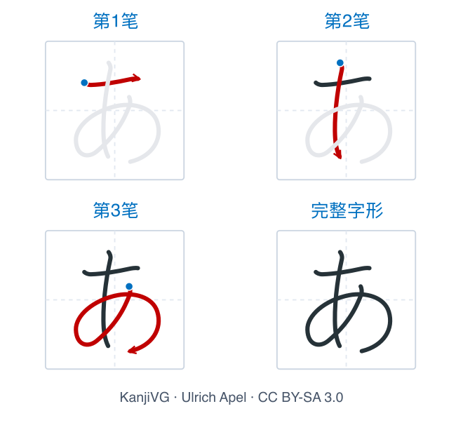

# 日语假名与日常表达

 

面向日语初学者的545张Anki卡片，提供完整的中文讲解版和英文讲解版。通过假名识读、笔顺练习和常用词与表达，把字形、读音和意思联系起来。

## 选择版本

按自己习惯的讲解语言选择。每个下载包都是独立完整的545卡牌组，选择一个版本即可学习全部内容。

- [中文讲解版](https://github.com/frankeenld-hub/Anki-Learning-Japanese-Hinagana-and-Katagana/releases/latest/download/Japanese-Kana-Foundations-Chinese.apkg)
- [英文讲解版](https://github.com/frankeenld-hub/Anki-Learning-Japanese-Hinagana-and-Katagana/releases/latest/download/Japanese-Kana-Foundations-English.apkg)

两个版本都用于学习日语。英文版使用英文解释日语的读音与意思。

## 内容安排

| 章节 | 每个版本的卡片数 |
| --- | ---: |
| 平假名识读 | 108 |
| 片假名识读 | 105 |
| 假名书写 | 217 |
| 日语常用词与表达 | 115 |
| **合计** | **545** |

平假名识读包含104张假名卡和4张读音提示卡。片假名识读包含104张假名卡和1张读音提示卡。

假名按五十音行分组，适合五个一组的内容放在同一行，例如かきくけこ（ka ki ku ke ko）。拗音按三个一组呈现，小假名与长音相关内容单独编排。

## 卡片特点

行对照表使用32 px假名与22 px罗马字，便于比较相邻字形与读音。绿色Notes讲解区使用原生HTML details折叠控件，默认展开，也可以收起后再回忆。

日语例子配有偏向实际读音的罗马字提示。例如こんにちは标作konnichiwa，因为这个问候语末尾的は读作wa。罗马字用于帮助过渡到假名阅读，学习时也要注意日语原文。

日语常用词与表达卡还展示写法与读音的联系，例如山 → やま → ヤマ（yama，山）。片假名栏用于练习两套假名的同音对应。少量不常见的声音组合用于发音操练，已明确标为练习组合。

书写卡采用SVG分步笔顺图。红色表示当前笔画，黑色表示已完成的笔画，蓝点标出起笔位置，箭头提示书写方向。

## 导入与学习

1. 下载所需讲解语言的.apkg文件。
2. 打开Anki，导入该文件。
3. 在牌组选项中设置较小的每日新卡数量。先从识读章节开始，再按能够坚持的节奏调整。
4. 翻面前先尝试回忆，再阅读讲解并跟读日语。
5. 书写卡可先照图写，再凭记忆写，最后对照完整字形检查。

## 日语发音

每张卡片均使用Anki原生ja_JP文字转语音。播放需要兼容的客户端与可用的日语语音。Linux还需要兼容的TTS引擎或插件。声音效果和实际发音取决于设备上的语音。牌组不附带预录音频文件。

若卡片没有声音，请检查日语语音是否可用，以及客户端是否支持TTS。具体说明见[Anki官方TTS文档](https://docs.ankiweb.net/manual/templates/fields)。

## 教学内容

讲解、提示和例子根据通用假名读音、拼写规则与日常词汇事实为本项目新编。教学文字采用AI辅助编写，已核对读音、例句、排版和文件完整性，用于入门学习与练习。

## 署名与许可

新编教学内容及改编后的笔顺图采用[知识共享署名—相同方式共享3.0未本地化版许可](https://creativecommons.org/licenses/by-sa/3.0/)。再利用与改编的具体条件见[许可法律文本](https://creativecommons.org/licenses/by-sa/3.0/legalcode)。

笔顺路径来自Ulrich Apel的[KanjiVG项目](https://kanjivg.tagaini.net/)，原素材采用CC BY-SA 3.0许可。本项目改编了布局与配色，用于逐步显示当前笔画、已完成笔画、起笔位置与方向箭头。分享改编作品时，请保留相关署名与适用许可。

详细来源及第三方声明见[SOURCES.md](SOURCES.md)和[THIRD_PARTY_NOTICES.md](THIRD_PARTY_NOTICES.md)。
